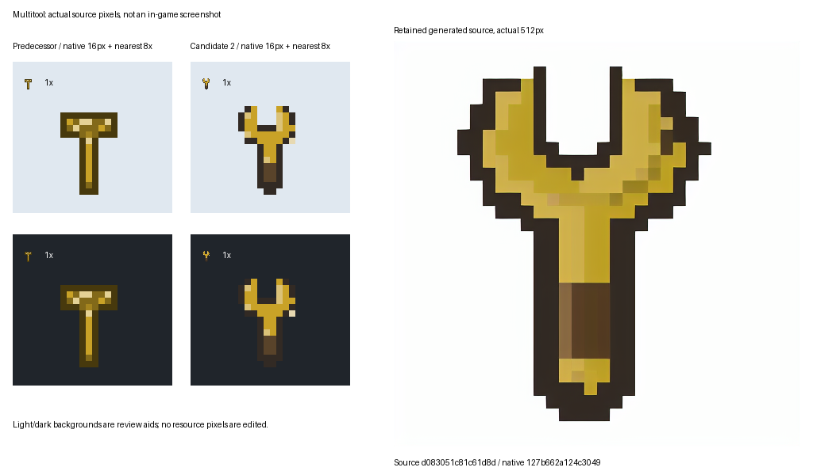

# Supervised local ComfyUI asset workflow

ADR-0157 makes ComfyUI a development-only **source candidate** backend, not the
Minecraft asset authority. No model, ComfyUI dependency, external image account,
Python dependency or network operation is added to the normal mod build.
Private host paths, personal workflows and generation endpoints stay outside Git.

**Current source candidate:** Multitool source2 is technically selected and its
223-byte native PNG is integrated through a hash-validated JDK-only source seam.
All580 other resource PNGs are byte-preserved. Both real source graphs are
retrospectively verified from their actual retained PNG prompt metadata after
the collector-integrity repair below. Human art/client acceptance and deployment
are not claimed. The first rejected source and original spent2/2 run remain history.

## Current bounded target and visual contract

The coordinator selected `grindless:multitool` after inspection of the actual
source PNG and `FormTextures.multitool`, which is explicitly a placeholder.
`MultitoolItem` rotates and relocates owned blocks; it does not mine. This item
is outside the nine protected material/core sprites and three reviewed guides.
Preserve its warm `#C9A227` brass identity, manual-tool silhouette, implied
material volume, upper-left lighting and T0 readability. Do not add powered
cyan, a battery, a mining head, tiny text or future-tier semantics.

The original [structured specification](../../tools/visual-assets/specs/multitool.json)
records materials, silhouette, motif, wear, static state, tier readability,
orientation, palette, source authorities, prompt and two fixed seeds. These
requirements decorate the existing item, not a second gameplay catalogue.
Only the shared item/material behavioral class is implemented. Machines, state
variants, books and UI need their own evidence before sharing this template.

## Inspection checkpoint

Source intake is exact `7e58f92e846f7580968393be0a2e0a99ed883e2c`.
Strict SSH inspected only the owner-identified installation and relevant model
references. No unrelated workflow prompts, private images, account logs,
credentials or process command lines were read.

Two installations exist: portable AMD at ComfyUI commit
`c2bcbecd82ec5ae66594340b395c24ef0217b238` and ROCm at
`a52921417de6232527bdddd1f325e693be88b448`, reporting version `0.32.0`.
The portable runtime has torch `2.9.1+rocm7.2.1` and Pillow `12.3.0`;
the ROCm runtime has torch `2.12.0+rocm7.15.0a20260728` and Pillow `12.2.0`.
Package metadata is not a backend or inference pass.

The portable model directories contain only eight tiny approximation models,
not a checkpoint. ROCm contains one 2,132,696,762-byte SD1.5 fp16 checkpoint,
Anima, Qwen conditioning/VAE and three LoRAs. Only the existing SD1.5 is selected;
no Anima/Qwen/LoRA or custom node is needed. The tensor header names Stable
Diffusion v1.5, and the actual checkpoint SHA-256 is
`e9476a13728cd75d8279f6ec8bad753a66a1957ca375a1464dc63b37db6e3916`.
The [model lock](../../tools/visual-assets/sd15-model.json) binds the actual
length/hash to Comfy-Org's immutable archive upload
`4fddeb7f9096623f1b77f4708feb96126a08a0cf`. Its git-LFS content identifier matches
the independently computed local hash exactly. The archive describes this file
as an FP16 conversion plus metadata header, not the original FP32 bytes.
CreativeML OpenRAIL-M section 6 claims no rights in generated output but forbids
output uses contravening its provisions, including use-based restrictions.
Do not use an unrelated mirror's MIT tag to relicense these weights.
No weights are downloaded, copied or distributed; no ComfyUI GPL source is
copied into this original API client or graph. This is not legal assurance.

Initial observation: zero Python/ComfyUI/Java processes and no listeners on
8188/8189; loopback `/queue` on 8188 is unavailable. Seven existing ROCm workflow
files were counted without reading their contents. No installation/workflow,
queue, model, driver, global Python setting, firewall or player instance was
modified by inspection. An auxiliary PowerShell metadata serializer emitted
oversized object metadata and was stopped; a bounded explicit-string collection
recovered the inventory. That observation failure is not a backend failure.
Local `python` is a Microsoft Store alias and exits 9009; the pipeline therefore
uses the already installed ComfyUI Python, not an automatic installation.

Under the coordinator's exclusive lease `ade517967975e2fff7438d942a2c5676248277f8`,
the existing ROCm Python 3.12.9 imports torch/HIP7.15.26290 successfully.
The actual device reports RX6700XT/gfx1031, 12,868,124,672 bytes total VRAM and
12,720,144,384 free before a 16-element native GPU kernel. Its real sum is16.0;
synchronization succeeds and allocated/reserved memory returns to zero.
No CPU fallback or runtime installation was used. This kernel is not diffusion
inference. A fresh preflight measured12.301GiB physical/29.394GiB commit and
157.846GiB work disk, with0Java/Python/listeners before that probe.

The separately owned server then becomes ready on loopback only. Its API confirms
ComfyUI0.32.0, the same torch build, the actual RX6700XT and the real core
`CLIPTextEncode` node. Both queue counts are zero; the listener belongs only to
the recorded owned Python PID. The private launch-argument digest is
`ccf8ba89859fbe866d77737a4c07cfd43d7eaf223426ad78b64f2c7c8085758c`.
No personal launcher, custom node, Manager, provider node or auto-updater is used.
This readiness is not an inference pass.

The frozen client `11b7f1ef3f6ca08a1928ec2bf3fe48b5cbad0a41ada2148354d76f8f29a8d5ef`
and test file `58cd8e30c1d31d50fd45e63430859b84d416efbaf8875581f783bb771848f611`
pass17 offline contracts in4.505s under the existing PC Python/Pillow, exit0.
The retained stderr log hashes to
`b8a55767001d1a58d19b2d8075bf2ad5d3367ce08c75e1b18ff5cf70ffc02936`.
Those use synthetic PNGs, a synthetic checkpoint and a loopback fake API, not
diffusion inference. Refusals cover changed model/spec, budget/slot exhaustion,
ambiguous submission, timed-out collection/resumption, duplicate sources, foreign
outputs, occupied queues, stale locks, invalid native pixels and source hashes.
The initial successful17-case run exposed Pillow's `getdata` deprecation warning;
the implementation now uses its existing supported flattened-data method, with
the duplicate-output disposition also explicit in the ledger. No real source
request was made by either test run.

## Reproducible generation and retained evidence

The original [API graph](../../tools/visual-assets/item-workflow.json) uses only
checkpoint loader, positive/negative CLIP, one 512-square latent, Euler/normal
KSampler at 20 steps/CFG7, VAE decode and SaveImage. Batch is one.
There are at most two sequential source reservations for this purpose.
Fixed seeds reproduce settings, not bitwise results across GPU/driver/runtime
changes. A cache hit or duplicate output is not independent inference evidence.

Run `visual-assets.ps1 -Python <existing-python> <action> ...`, or set `PYTHON`
and use the Bash twin. Both call the same original Python implementation.
No automatic package/model/node install, server launch, queue cancellation,
deployment or GPU fallback is hidden in either entrypoint.

1. Obtain a coordinator resource lease and refresh physical/commit/disk/process
   guards. Qualify the existing GPU runtime; never present CPU fallback as GPU proof.
2. Launch only an owned loopback server with custom/provider nodes and Manager
   disabled, browser launch disabled, and owned input/output/user/temp directories.
   Preserve the launcher digest, own PID, runtime code identities, raw failures,
   readiness and actual GPU memory observations outside Git.
3. `plan --spec <spec>` resolves the pinned model and original graph without
   submitting anything. `generate --allow-generation --spec <spec> --checkpoint
   <existing-file> --run-dir <owned-run> --slot 1` checks the model length/hash,
   queue emptiness and core node metadata before reserving a slot durably.
4. Reservation precedes the one `/prompt` POST. Transport ambiguity spends that
   slot; do not retry. `collect` resumes only a known recorded prompt through its
   exact `/history/<id>` and `/view` output. Never fetch another user's history,
   dump `/queue` bodies or call interrupt/delete APIs.
5. Retain the original source PNG, resolved workflow, spec, runtime metadata and
   request ledger. The client refuses duplicate sources, foreign output paths,
   redirects, proxy routing and non-loopback endpoints.
6. Run `process --spec <spec> --source <retained-png> --source-sha256 <hash>
   --output <new-directory>`. Processing never overwrites the source or a prior
   output directory. Review source pixels and the actual 16px result separately.

The finite reservation ledger protects one declared run, not an authorization
to create unlimited new runs. Parent approval still controls the purpose and
total allowance. A failed/unknown submit, timeout or execution remains visible.
The client never cancels a job. Stop only its positively identified server PID,
then report the free port, zero remaining owned processes and released resources.
Never reboot the PC.

### First real inference and observation repairs

Source tooling was committed as `9ee1af396243f83bff5d0d85502672ec322dcccc`
before the first real source request. The first private helper stopped before
any reservation/POST because WinPS parsed an ISO-Z time as Local and subtraction
against UTC produced a false -7200s identity mismatch. Read-only recovery proved
the same PID, executable and creation instant, zero queues and no run directory.
The corrected helper compares `DateTimeOffset.UtcDateTime`; no identity guard
was weakened, no server restarted and no request allowance was consumed.

The first actual prompt is `4ed2fadf-5cf1-4840-92bb-0bc16ed2644b`, seed21774205.
Its own history records success, no cached nodes, execution start1792462071512
and success1792462150158; the server reports78.65s. The frozen original client
then fails collection with `Unsafe output subfolder`: native Windows ComfyUI
returns a backslash-delimited subfolder. The original exit1 receipt remains,
with stderr hash
`df84ee0e076df22b935353dfb0a46082599b10418219151b52140f68e894e0e3`.
This is a collector portability defect, not a model/GPU failure.

The targeted repair normalizes native separators before the same exact
run/candidate/path-traversal checks; it does not broaden output ownership.
The revised17-case contract suite, including Windows normalization and traversal
refusal, passes in4.600s. Client SHA-256 is
`e1327f44a2378459ae0aed4389afda4fe9f231b4024b26eaebf7399d340a1cee`,
test SHA-256 is
`d35440259d6d455f34fc5d4aa70546011c3c183ca1a4c43f6a7ee24d46ac43de`
and log SHA-256 is
`2b108e5c20e383a6cc8e4477af133394e1f4daff3e9566f9aaa66fe878d6c7cb`.
Collect the existing prompt; do not submit again to repair its observer.
Before that inference the refreshed guard had11.480GiB physical/26.998GiB commit,
157.252GiB disk, zero Java/other Python and12,720,144,384 free VRAM bytes.
Afterward both queue counts were zero and12,439,257,088 VRAM bytes were free.

Collection of that same prompt succeeds without another POST. The retained
512px source is537,133 bytes, SHA-256
`e77dca20fb9b0c57a735b2fddc37070730e239458e689d12d880ad735faf0924`;
its resolved graph hashes to
`6d102bfbf69237a4eed7d537852cc3a44d7be5389ab717cfc5b398c87b1b8b08`.
Source-pixel inspection finds a photographic hexagonal brass part on fabric,
not the specified open-jaw hand wrench on white. The deterministic processor
correctly refuses its non-background source edge. No native candidate is written,
no threshold is weakened and no resource is replaced. Diffusion success is not
useful-art success.

Raw rooted/drive/UNC/empty/dot/traversal components are now rejected **before**
native separator normalization; valid Windows and POSIX references to the exact
same owned output remain accepted. The18-case suite passes in3.116s, with log
`e22de55859727dd7c43776e89655ff1c11bd3412ddf5f2e423d084bdc3fcd556`.
The second reservation remains unused. A purpose-preserving conditioned workflow
for that remaining candidate is proposed rather than another blind source request.

### Approved remaining-source conditioning

The coordinator explicitly approved the second and **last** source with an
original geometric guide, the same model/seed21774206,20Euler/normal steps,
CFG7/batch1 and denoise0.35. The
[conditioned spec](../../tools/visual-assets/specs/multitool-conditioned.json)
retains the original gameplay/visual/transform contract and adds only the guide.
The [eight-node graph](../../tools/visual-assets/item-conditioned-workflow.json)
reuses the core pipeline, replacing the empty latent with LoadImage/VAEEncode.
No LoRA, custom node, new checkpoint or unrestricted generation is introduced.

`guide` draws the project-original32px open-jaw wrench with brass bevels, dark
grip and upper-left highlights, then enlarges it to512 with nearest sampling.
Its1948-byte PNG hashes to
`ee974047fdd07ba2da2e84d510fa7e635e2932d9155fb488f9f9143eaf79ca15`.
The input lives only in the isolated owned input directory; generation verifies
its hash and exact frame/dimensions before any reservation or POST.

`revise --expected-ledger-sha256 <exact-before> --revision-reason <approval>`
creates one new exclusive `authorization-2.json`, not a replacement ledger.
It binds the original run identity and first request hash, the new spec/template/
guide, allowed slot2, spent1, remaining1 and unchanged maximum2. The before-ledger
hash is `724edcd0276d2c196fee4e55f533dea8d13919b2f3b0083a5d4f8965d732eeba`.
The operation does **not write** `run.json`, `spec.json`, source1 or receipt1.
Only the ordinary second reservation appends its own row and new spec/workflow2.
No unresolved first delivery, changed purpose/model/seeds/contract, stale ledger,
second amendment or increased allowance is accepted. A21-case offline run
passes4.099s, including byte-identical first ledger/spec/source through revision
and total-two exhaustion; a final spec-bound freeze precedes the real second POST.
That final21-case run passes3.674s, exit0, log SHA-256
`7e8a8e7e78059bcdd78e06376bb3ae116c2263a0d4ea15e499106d540220ffb0`.
Its client hashes to
`1b88c1029c3cdfb054f10a843ff600113faf3b16071c95571482de8b09e193e0`,
conditioned template to
`d95782c1103edf8a740efe78a8d0be2a7ac9380662c31fe66c7f88a85646c78b`,
and raw conditioned spec to
`18d9eba67b6f40723975e5f5da6594c57d04738d03343f9e6cb9c17b0f696d35`.
Actual guide pixels were inspected separately: the open jaw, narrow manual grip,
warm metal, light/dark faces and clean white border match the input contract.
This is guide/source preparation, not human approval or a second inference.

The app's temporary error notification did not establish a GPU failure. A fresh
read-only recovery confirmed the same PID/executable/startUTC, loopback listener,
zero queues and exactly one collected request. No authorization2 or candidate2
execution output existed. The owner later reported a brief restored Internet
outage. No new session, server restart, request replay or quota was created.

### Actual second source and deterministic result

Source2 prompt `318be6d6-ca2a-41ea-8b1d-a3f70c20988e` completes successfully
with no cached nodes in21.710s of recorded prompt execution,25.399s including
the client/model-hash boundary. Its86605-byte source hashes to
`d083051c81c61d8d42158debd5afbb24b347bf77fa271ef41d10044a8f51f615`.
The reserved resolved graph hashes to
`7940c2cbbf60fcd5e72854deb843debe268b458962fc6e2fc65e19717a806d41`.
Its immutable seed21774206,0.35 denoise,20Euler/normal steps,CFG7 and single
512-square image are recorded in the
[public provenance](../../tools/visual-assets/approved/multitool.provenance.json).

The unchanged processor passes: crop[80,32,400,480], foreground fraction
0.27965545654296875, zero dust, no rotation/mirroring, fixed seven-color palette,
nearest14px envelope and binary alpha. The16px PNG is223 bytes and hashes to
`127b662a124c30490c3d6737dc29ce8175d37b201e45bdad18bc1ea7360c7d38`;
RGBA bytes hash to
`e5a5e6ebf7260b3d2e0f61224447a99197a1e08eb7028da01edab3fa4627c5ba`.
The coordinator inspected the actual comparison and selected this technical
candidate without further pixel edits. The predecessor, guide, source2, resolved
graphs, processing, spent ledger and append-only authorization are retained under
`tools/visual-assets/poc/`. The rejected fabric photo is not imported as source
art or runtime; its original remains private and its rejection/integrity is public.

`compare` renders the real predecessor/native16px at1x/nearest8x on light/dark,
beside the untouched512px source. It writes only a new review image, never resource
pixels. The actual comparison SHA-256 is
`bfc4487955ec8678db9e397e9d7a1f531b0039dc10404d465e268d0c210b7f45`.
Its font/raster presentation is a review aid, not Minecraft rendering evidence.

The owned server is explicitly stopped after both queues are empty and both
owned prompt histories report success. At02:32:21Z its verified PID11548 is gone,
8189 has no listener and Python/Java counts are zero. Free physical/commit/work
space is11.370/35.225/155.970GiB. Rehashing proves installed main/nodes/model bytes
equal their intake identities. The stopped-server launcher returns0. No user
process is stopped, no install/model download occurs and no PC reboot occurs.
The initial owned evidence is63 files/1,390,353 bytes; later CPU/source snapshots
are separate tooling data, not a model download. Private receipt paths stay private.

### F1 collector-integrity correction and actual retrospective proof

Independent review of the earlier client correctly found that collection trusted
a retained workflow's prefix without checking its reserved digest or historical
graph. The successful GPU jobs do not excuse that tooling defect.

`reserved_workflow` now validates exact retained file bytes against the reserved
SHA-256, the reserved spec/template/typed seed, and a reconstructed approved graph
with a prefix derived independently from asset/run/slot **before any HTTP request**.
Changing local seed, prompt, prefix, model or digest fails with zero API calls,
including a rewritten digest accompanying a changed graph.

Live collection additionally verifies ComfyUI0.32's owned history tuple:
`prompt[1]` must be the recorded prompt ID and `prompt[2]` must hash to the reserved
approved graph before `/view` or collection. An actual owned history proof is saved
for future collections. If a returned PNG has `prompt` metadata, that graph must
also match. Absent PNG metadata is permitted only with that real verified live
history; offline retrospective auditing never invents it.

Only JSON object-key order/serialization whitespace are ignored when comparing
parsed history/PNG graphs. No fields, values or numeric/string/boolean types are
dropped or coerced; retained workflow file bytes themselves must match exactly.
Windows/POSIX references to the same canonical output remain valid; raw
root/drive/UNC/empty/dot/mixed traversal and foreign outputs remain rejected.

The repaired client
`1dfabafb970614a4726e60a2937d7e7f9d270bc55533b3d22e4838180368d8d4`
and tests
`b2e63c182cb41a24e3f46a35ad582a6f33fe19fc2f1b5fe381cf8e9d11c3ce8d`
pass27 contracts in4.961s; log SHA-256
`1a35fdcb8767e710a9adea317c20e8fdd304a0f715320e3f670211df51faaafd`.
Positive collection resumes GET-only, URI-encodes its query, checks real PNG
metadata and preserves ownership. History/PNG mismatches cannot become collected.

The original live history graph was not archived before stopping the server.
The separate `audit` action therefore uses the actual retained, hash-pinned PNG
`prompt` metadata, not a fabricated later history observation. It verifies exact
graph6d102b... for source1 and7940c2... for source2, including model, typed seeds
and canonical prefixes. Both real audits pass with zero network requests or new
inference; the original ledger remains
`2bbcfbc970b5a1164c15ba330670096b52e884f68cb61634339039c1ef700624`.
The new exclusive
[source1 addendum](../../tools/visual-assets/poc/multitool-integrity-1.json)
hashes to `7baaa13d2a996c5cea9f8835eb97341c62c7b45ba6e80df417ee74c8289c0b0f`;
the [source2 addendum](../../tools/visual-assets/poc/multitool-integrity-2.json)
hashes to `0936883c8ac58afe8bfbf85b5d86aa0d03450ec4ab746b9ca914fac851565890`.
Original receipts, failed observations, request allowance and rejected-source
disposition are not overwritten to close F1.

The first integration archive exposed Git's Windows text conversion changing
the raw retained JSON identities even though parsed graphs stayed equal.
That archive's SHA-256 is
`97a7aa4f65eb4a7ee6d121b05941ea4fc23fa6ef1bc39f5c3666c6b9e4393729`;
it was inspected before any JDK run, not accepted as byte-preserving evidence.
The scoped `.gitattributes` now preserves exact JSON bytes across checkouts and
archives, and the committed-source contract checks raw workflow, run, processing
and audit-addendum hashes in addition to graph/content identities.
The first raw-byte staging attempt flagged the recorded CRLF terminators as
trailing whitespace. The scoped attribute now recognizes CR-at-EOL while keeping
blank-at-EOL/EOF and space-before-tab checks; no receipt bytes are edited to pass.

## Deterministic transformation and integration boundary

The pipeline accepts only the graph's single-frame 512px PNG. It removes only
edge-connected near-white/transparent background, bounds foreground coverage,
and refuses detached substantial objects. The declared tiny dust allowance is
recorded, not silently generalized into object removal. It crops the retained
object, preserves orientation without rotation/mirroring, fits a 14px envelope
using nearest-neighbor sampling, quantizes to the declared material palette and
writes canonical zero-RGB transparency and hard alpha.

Checks cover 16px dimensions, format/frame, palette membership, transparent
one-pixel margin, connected silhouette, material-tone separation and hashes.
These are technical checks, not proof of correct wrench semantics, good art,
upper-left lighting, originality or actual inventory/JEI rendering.
The processing receipt records Python/Pillow versions, source/spec/template
hashes, crop, dust, transform identity and both RGBA/PNG hashes.

The approved16px source now exists at `tools/visual-assets/approved/multitool.png`,
with a plain SHA-256 sidecar linked to full provenance. `GenerateAssets` verifies
the sidecar, source hash, PNG signature,16px dimensions and binary alpha before
normal output mutation; it copies those exact bytes instead of the placeholder.
There is no fallback to a stale generated tool. Guides-only remains independent
of this source and preserves its original three-output mode.
The normal generator needs only its existing JDK, never ComfyUI, Python, weights
or network. The original `FormTextures.multitool` and retained predecessor remain
historical source, not a second active authority.

`VerifyApprovedMultitool.java` exercises the real JDK reader, tamper/format/
dimension/alpha/missing-source refusals, failure-before-output and guides-only
behavior. Its actual exact-source qualification is recorded below; it is not a
Gradle, server/client or deployment run.

The PowerShell and actual Windows Git-Bash entrypoints both execute an offline
conditioned `plan`, exit0, with identical raw JSON SHA-256
`e937dca9a5326b582dfe7c92b934a6f955e7f4a5140ef248fe5d78e24f1c09e6`.
The default plan uses seed21774205 with0.35 denoise; it submits nothing.
This is Windows entrypoint parity, not a claim of Linux execution.

## Exact-source normal-generator qualification

The separate JDK lease validates immutable
`c214d437a652cb1bcd1c698694953be67331089a`, source archive
`cfcf877e812ee0fd80bb260735f86b53946695f1d7fba95abe13355c696e5385`
(3,329,002 bytes). Existing JDK17 is headless, capped256MiB/CPU2/SerialGC.
The standalone classpath compiles only assetgen, SupplyCatalogue, MaterialForm,
BlockCatalogue, WorkshopGeometry and the focused verifier; no Minecraft/Forge
classpath, Gradle, server, world, Prism or shared/default PC surface is used.

The [portable proof](../../tools/visual-assets/poc/multitool-jdk-validation.json)
retains actual exits/times/log identities:28 Python contracts pass in5.126s,
javac exits0,12 actual JDK checks exit0, and two full normal generations exit0
in2.028s/2.034s. The raw normal generator reports1520 outputs each; the complete
seeded stage trees contain1602 files each and are byte-identical, with sorted
manifest SHA-256
`3b9e22d1afe6f560dec85f3324146af9403adde343fb2ef1954f49ef11916dfb`.
The selected PNG stays exactly127b...; all581 resource PNGs match the integrated
source, including580 other PNGs and all nine material/core plus three guide sprites.

Normal-generation text differs from source only in933 CRLF/LF serializations
and the intentional generated provenance paragraph. Those staged text files,
smoke fixtures and preview are not copied into source/runtime. The existing
settling preview is byte-identical; four standard states side texts differ only
by EOL. The common generated provenance document alone is synchronized with the
qualified renderer so normal regeneration does not reintroduce stale guidance.

The first private observer failed after **all six process steps exited0**:
its staged input omitted five existing normal side-output files and it treated
their creation as unexpected. Preserve original receipt
`e7fb57653d7ac2d9d40a88c2e881d4110a6628a29109ce478286f72f7d8f0a5f`.
Read-only recovery compares both already closed stages and their exact source
baselines, with no JVM/stage replay. The recovered addendum hashes to
`aee17226076535ea37726033664377f72e572b9c6bb376f328774f4a8be30b69`;
the original stays unchanged. A local WinPS helper line-continuation parse refusal
was corrected before that read-only helper was transferred or executed.

At03:14:10Z the JDK lease is explicitly released:0Java/0Python/0owned listeners,
9.036GiB physical,27.174GiB commit and155.022GiB work free. The full owned
source/stage/evidence surface is17,595,638 bytes, about16.8MiB, with no model copy.
Subsequent proof/documentation/provenance synchronization does not change the
validated renderer, template, processor or selected PNG assumptions; do not rerun
successful stages merely to advance the handoff commit.

## Checkpoint disclosure

| Category | Actual final bounded handoff |
| --- | --- |
| COMPLETED | Reusable bounded local pipeline; two real sources, first rejected/second technically selected; native source/runtime integration; F1 repair and actual PNG audits;28 Python/12 JDK checks; two byte-identical full stages;580 other PNGs and9+3 protected; GPU/JDK released. |
| BLOCKED | None. Original preflight/collection/archive/observer failures are retained with bounded fixes/addenda. |
| NOT EXECUTED | Parent build/package/deployment, native client/JEI rendering and human campaign; no new Linux run is claimed. |
| NEEDS HUMAN VALIDATION | All appearance, readability and actual client contexts. |
| NEEDS MY DECISION | None; the coordinator selected native127b and the source seam. |
| NEEDS CREDENTIAL / EXTERNAL RESOURCE | None; existing SSH and local runtime are available. |
| COST / BILLING RISK | No paid service/model download. Original run is spent2/2; no extra inference is needed or performed. |
| DEPLOYED STATE | Qualified559 remains unchanged; the new sprite is source-integrated, not deployed. |

| ComfyUI category | Actual state |
| --- | --- |
| COMFYUI ENVIRONMENT FOUND | Two installations; no API initially, then an isolated owned loopback API qualified separately. |
| REUSED COMPONENTS | Existing SD1.5 fp16, incorporated CLIP/VAE and existing Python/Pillow; no model copy. |
| INSTALLED/CHANGED COMPONENTS | Original project tooling/source/one runtime sprite; owned temporary server stopped. No installer, driver, model/config/workflow rewrite or public service. |
| MODEL/WORKFLOW SELECTED | Exact Comfy-Org SD1.5 FP16; txt2img source1 rejected, core eight-node guide-conditioned source2 selected. |
| AUTOMATION METHOD | Loopback prompt/history/view; original deterministic offline processor. |
| POC ASSETS GENERATED | Two retained real source candidates for one logical asset; only source2 passes technical selection. |
| ASSETS INTEGRATED | One16px Multitool source/runtime PNG and coherent generated provenance; normal JDK regeneration preserves it byte-identically. |
| NEEDS HUMAN VISUAL VALIDATION | Actual appearance/native inventory/JEI; source-pixel technical selection is not human approval. |
| BLOCKERS | None. Parent publication/build/deployment and human appearance remain distinct downstream work. |
| DISK/COMPUTE IMPACT | Zero model downloads/copies; two bounded prompts,17.6MB owned snapshots/evidence,256MiB/CPU2 JDK gate; zero remaining processes/listeners. |
| LICENSING/PROVENANCE NOTES | Model/guide/source/settings/native provenance and notices precede import; no weights or GPL code distributed. |
| RECOMMENDED NEXT ASSET WAVE | Reuse the proven guide-conditioned item/material mechanism only for a demonstrated weak asset; no mass replacement or invented future-tier content. |
